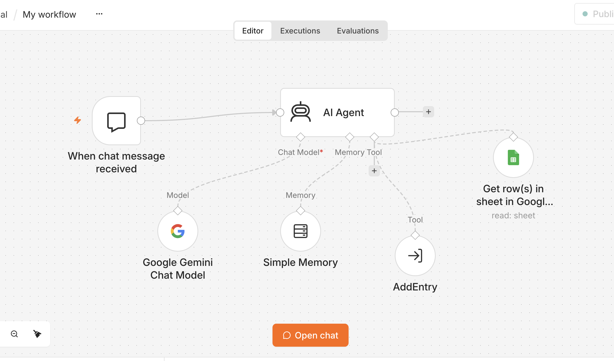
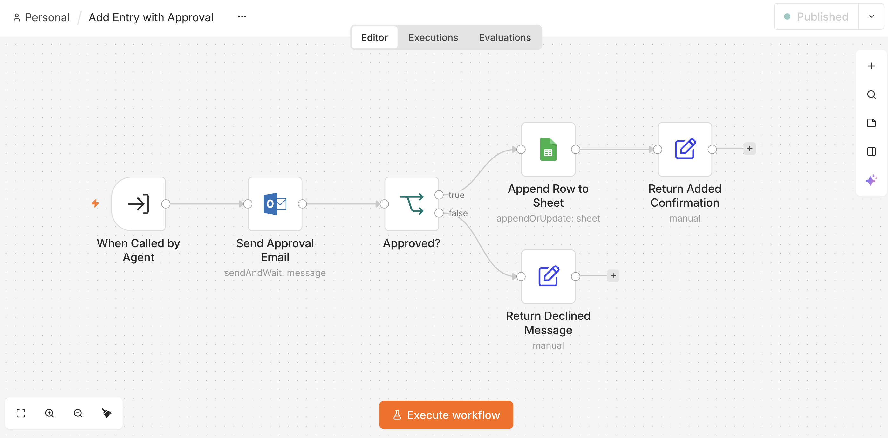

# Subscription Tracker Agent (n8n + Gemini + Google Sheets)

A small personal agent I built to log my recurring expenses by chat, with a human approval step before anything is written to the sheet.

**Why:** I kept forgetting which subscriptions were active and what they cost. I also wanted a hands-on test of the same design rules I apply to production AI products: constrain the output schema, confirm before you write, and keep a human in the loop for anything irreversible.

## How it works

1. **Chat trigger** - I describe a subscription in plain language ("just signed up for ChatGPT, 20 usd a month").
2. **AI Agent (Gemini)** - extracts five fields (Expense, Charge Date, Cadence, Cost, Status) against a strict schema with enumerated values and defaults, checks existing rows, then shows a summary and asks for confirmation. It never writes before an explicit "yes".
3. **AddEntry tool** - calls the sub-workflow below with the confirmed values.

4. **Approval sub-workflow** - sends an Outlook email with approve / decline buttons (`sendAndWait`), branches on the answer, appends the row to Google Sheets only on approval, and returns a plain-text result to the agent.

## Design choices

- **Schema-constrained extraction.** Cadence and Status are closed enums; dates are resolved against today's date in my timezone. This keeps the sheet filterable and avoids silent drift.
- **Confirm-before-write.** The agent must echo the exact values and get a confirmation before calling the tool. Corrections re-trigger the summary.
- **Human-in-the-loop gate.** Even after chat confirmation, the write is gated by an email approval. For a personal tracker this is overkill; it is here because it is the pattern I would ship for any agent with write access to a system of record.
- **Deterministic sub-workflow, probabilistic agent.** All side effects live in the sub-workflow with no LLM in the path; the agent only decides *what* to write.

## Files

- `workflows/01-subscription-tracker-agent.json` - chat trigger, agent, memory, tools
- `workflows/02-add-entry-with-approval.json` - approval email, branch, sheet append

Credentials, sheet IDs and email addresses are replaced with placeholders. Import both into n8n, set your Gemini, Outlook and Google Sheets credentials, replace `<YOUR_SHEET_ID>` and `<approver@example.com>`, and point the AddEntry tool at the imported sub-workflow ID.

## Related

- LiveChamp content-compliance grading demo (Coze): https://www.coze.cn/s/zinHsQMtpZQ/
